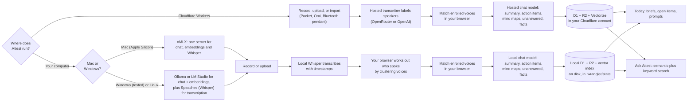

# Attest

**Record a conversation. Get back who said what, what was decided, what you owe people, and a memory of your work that gets smarter every week.**

Attest is a private, self-hosted voice notebook. Run it on **your own Mac** (with a local model server, nothing leaves the machine) or as a Worker in **your own Cloudflare account**. You record (or upload, or import from a Pocket device, an Omi account, or a Limitless pendant), and Attest gives you a speaker-labeled transcript, a summary, action items, mind maps, and a searchable memory of everything you have ever recorded. Then it uses that memory to run your day.


**Jump to:** [Why Attest](#why-attest) · [A day with Attest](#a-day-with-attest) · [Features](#features-at-a-glance) · [How it works](#how-it-works) · [Quick start](#quick-start) · [Full setup guide](#full-setup-guide) · [Using Attest](#using-attest) · [Cost](#cost) · [Run locally](#run-it-locally-on-a-mac-omlx) ([Windows/Linux](#run-it-locally-on-windows-or-linux)) · [Privacy](#privacy-and-security) · [Troubleshooting](#troubleshooting) · [Limits](#known-limits-honestly) · [For developers](#for-developers)

---

## Why Attest

Most AI note-takers are a monthly subscription, keep your conversations on someone else's servers, and forget everything the moment the meeting ends. Attest is built the other way round.

- **Your conversations stay yours.** Run it on your own Mac, where nothing leaves the machine, or in your own Cloudflare account. There is no Attest company server, no sign-up, no plan and no usage limit. See [Privacy and security](#privacy-and-security).
- **It costs pennies, and you can see exactly what.** No subscription: you pay your AI provider directly, about **$0.10 for an hour of recording**, speakers included. Or pay nothing at all by [running it on your Mac](#run-it-locally-on-a-mac-omlx). Every recording shows what it used. See the [cost comparison](#compare-routes).
- **It knows who said what, and never guesses.** Teach it a voice once and it recognises that person in later recordings. It only puts a name on someone when the transcript proves it, and a voice match stays a suggestion until you confirm it. Your audio is never sent anywhere to do this. See [Speakers and voices](#speakers-and-voices).
- **It remembers, so you don't have to.** Every promise, decision and preference from every conversation is kept with the quote behind it. "What did Ben promise me?" gets an answer in seconds, with the source, instead of an hour of re-reading notes. See [Memory and semantic search](#memory-and-semantic-search).
- **It plans your day.** Open Attest and Today shows what you owe people, what is waiting on you and what is overdue, with a daily brief and a weekly review that write themselves. Ten one-click prompts cover the rest: prep me for a person, what did I promise, coach me, and more. See [the Today screen](#the-today-screen).
- **No lock-in.** Use OpenRouter or OpenAI, or a model on your own Mac, and switch whenever you like without redeploying anything. See [Providers and keys](#providers-and-keys).

> Attest is not a hosted service. You run it yourself, so no one else operates a server that holds your recordings. The only thing that ever leaves your setup is what you send to the AI provider you chose, and with a model on your Mac, not even that.

## A day with Attest

1. **Morning.** Open Attest. Today shows a brief of what you committed to, who is waiting on you, and what is unresolved. Three action items are flagged overdue.
2. **Meeting.** Hit Record (or drop in a file, or let your Pocket device sync). Attest transcribes it, labels the speakers, recognises two of them by voice, then summarizes with their names in it.
3. **Right after.** You confirm one suggested name with a click. You tick off an action item. Both are saved.
4. **Before a call.** Pick a person, click **Prep me for [person]**. You get the last few conversations in brief, open items in both directions, and what they care about, with quotes as evidence.
5. **Friday.** The weekly review has already written itself: themes, decisions, unresolved questions, one thing to focus on next week.
6. **Any time.** Ask Attest "who owes me a decision?" and it answers from the right passages across everything you have recorded, with citations.

## Features at a glance

| | What you get | Needs | Details |
|---|---|---|---|
| **Record, upload, import** | Browser recorder with live preview and crash recovery, file upload, Pocket import, Omi import | nothing extra (Pocket and Omi need a key) | [Recording](#recording-uploading-importing) |
| **One recording, one conversation** | Dead air is trimmed, different conversations are split apart, and pieces of one call are joined back together. Originals are kept and every change can be undone | nothing | [Conversation shaping](#conversation-shaping-one-recording-one-conversation) |
| **Areas** | Every recording is filed under Work, Personal, Health or Learning, picked for you and easy to change; one dropdown at the top shows only one area | nothing | [Areas](#areas-work-personal-health-learning) |
| **Devices you choose** | Tick the ones you use (the app, Pocket, Omi, a Limitless pendant); the main screen, setup and background sync follow your choice | nothing | [Choosing your devices](#choosing-your-devices) |
| **Phone and Mac app** | Attest in a native shell, a bottom tab bar on phones, and a **Bluetooth pendant sync** with background upload on iPhone | an Apple developer account to run it on your phone | [apple/README.md](apple/README.md) |
| **Android app** | Attest in a native shell with the phone layout, plus **Share > Upload to Attest** from any app with background upload. No pendant | Android Studio to build it; no developer account | [android/README.md](android/README.md) |
| **Speaker labels** | Who said what, from OpenAI's diarize model or OpenRouter models that label speakers | a labeling transcriber | [Speakers and voices](#speakers-and-voices) |
| **Evidence-only names** | A name is kept only if a quote proves it; otherwise `Unknown 1..N` | nothing | [Speakers and voices](#speakers-and-voices) |
| **Voice recognition** | Enrolled voices recognised on any provider, in your browser | a 49 MB model, downloaded once | [Speakers and voices](#speakers-and-voices) |
| **88 summary presets** | Meeting, sales call, interview, lecture, medical visit, and 80 more, plus your own | nothing | [Summaries and mind maps](#summaries-and-mind-maps) |
| **Three mind maps** | Topic, driver (decisions and actions), people | nothing | [Summaries and mind maps](#summaries-and-mind-maps) |
| **Today screen** | A daily brief that leads the screen (do first, due and overdue, waiting on others, decisions, who to follow up with), a to-do list sorted by when it matters, a weekly review, 10 prefilled prompts | nothing | [The Today screen](#the-today-screen) |
| **Memory** | Verified facts per recording, plus talk balance and unanswered questions | nothing | [Memory and semantic search](#memory-and-semantic-search) |
| **Semantic search** | Ask by meaning across your whole history | Workers AI and Vectorize (free allowances, set up by deploy) | [Memory and semantic search](#memory-and-semantic-search) |
| **Ask Attest** | Chat threads, plus a deeper 3-pass research mode | nothing | [Ask Attest](#ask-attest) |
| **Export** | `.md`, `.docx`, a `.zip` of everything, print to PDF | nothing | [Export](#export) |
| **Run it locally** | Everything on your Mac with [oMLX](https://github.com/jundot/omlx): $0 in API fees, nothing leaves the machine, with semantic search and speaker detection by voice | Apple Silicon Mac | [Run it locally](#run-it-locally-on-a-mac-omlx) |
| **Lockdown by default** | Refuses every request until Cloudflare Access is in front of it | a Cloudflare account | [Privacy and security](#privacy-and-security) |

## How it works



**On Cloudflare**, everything is one Worker with owner-scoped rows. Your browser tab drives processing, and a free 15-minute cron picks up Pocket and Omi imports (the ones you ticked) and builds memory for older recordings. Start at [Route A](#route-a-cloudflare--openrouter).

**On your own computer** (a Mac, or a Windows PC; Linux should work but is untried), the same Worker runs in Cloudflare's local runtime (`npm run local`) and talks to model servers on your machine: oMLX on a Mac, or Ollama (or LM Studio) plus Speaches on Windows. The Windows path has been run end to end on Windows 11 with Ollama and Speaches; LM Studio, whisper.cpp, Linux and deploying to Cloudflare *from* Windows have not been tried yet. Nothing leaves your computer, speakers are detected in your browser rather than by the transcriber, and there is no background cron: use **Build memory from past recordings** and **Import from Pocket** instead. Start at [Route B](#route-b-this-mac-only), or [Windows or Linux](#run-it-locally-on-windows-or-linux).

Details for both are in [For developers](#for-developers).

## Quick start

> **New here? Follow [SETUP.md](SETUP.md).** It is a complete, step-by-step guide for every route, written for someone who has never used a terminal, with a "you should see…" check after each step and a fix for each common problem.
>
> **The short version of our advice: use Route A (Cloudflare + OpenRouter) and accept every default.** It is the one that is simplest to keep working, works from your phone, and processes recordings while you sleep. Choose a local route only if keeping everything off the internet matters more than convenience.

**Pick one route.** Both give you the same app; they differ in where it runs and what it costs.

| | **A. Cloudflare + OpenRouter** | **B. This Mac only (oMLX)** |
|---|---|---|
| Open it from | any device, a phone included | the Mac it runs on |
| Costs | about $0.10 per recorded hour | $0 in API fees |
| Needs | a Cloudflare account **and a domain** on it, an [OpenRouter](https://openrouter.ai/) or [OpenAI](https://platform.openai.com/) key | an Apple Silicon Mac (macOS 15+) with [oMLX](https://github.com/jundot/omlx) |
| Setup time | about 20 minutes, mostly dashboard clicking | about 15 minutes, mostly waiting for model downloads |
| Background sync (Pocket, Omi) | yes | no |

**Both routes need** [Node.js](https://nodejs.org/) 22.12 or newer: the install, the local server and the Cloudflare deploy all run on it. Then get the code and install it. With [Git](https://git-scm.com/downloads):

```bash
git clone https://github.com/techjeffe/Attest.git
cd Attest
npm install
```

No Git? Use **Code, then Download ZIP** on the [repository page](https://github.com/techjeffe/Attest), unzip it, open a terminal in that folder, and run `npm install`.

### Route A: Cloudflare + OpenRouter

First [create a free Cloudflare account](https://dash.cloudflare.com/sign-up) with a domain on it, and an [OpenRouter key](https://openrouter.ai/keys). The one-time dashboard steps are in the [Full setup guide](#full-setup-guide).

```bash
npx wrangler login   # opens your browser to sign in to Cloudflare
npm run deploy       # a wizard asks for your hostname, email and API key
```

When the wizard asks for a provider, press Enter (the default is `openrouter`) and accept the defaults (`openai/gpt-oss-20b` for chat, `microsoft/mai-transcribe-2` for transcription). That is [the recommended route](#the-recommended-route). Then open your hostname, sign in with the emailed code, and record something short.

### Route B: This Mac only

1. **Install oMLX** from its [official repository](https://github.com/jundot/omlx) ([site](https://omlx.ai)) and start its server. Set an API key in its settings; Attest will ask for it.
2. **Download three models inside oMLX** (its admin page, Models, search Hugging Face): one for chat, one for transcription, one for embeddings. [Which ones](#models-to-download) and why.
3. Back in this folder:

```bash
npm run setup:local   # finds your oMLX, tests each model, writes .dev.vars
npm run local         # then open http://localhost:8787
```

If anything fails, `npm run local:check` says which model or step and how to fix it. Details: [Run it locally on a Mac](#run-it-locally-on-a-mac-omlx).

**On Windows or Linux?** Same commands, with LM Studio or Ollama in place of oMLX and a separate Whisper server for transcription: see [Run it locally on Windows or Linux](#run-it-locally-on-windows-or-linux).

Want to hack on the code instead? See [Local dev](#local-dev).

---

## Full setup guide

Attest ships locked down: it has no public URL until you give it your own hostname, and it refuses every request that has not passed Cloudflare Access. That is deliberate (without it, anyone with the URL would share one set of recordings), so there are a few Cloudflare dashboard steps. The setup wizard (`npm run deploy`) automates everything after them. Until Access is in place the app answers `401` to everyone; that is it failing closed.

**On this page:** [Before you start](#before-you-start) · [1. Enable R2](#1-enable-r2) · [2. Set up Zero Trust](#2-set-up-zero-trust) · [3. API token (optional)](#3-optional-api-token) · [4. Run the wizard](#4-run-the-wizard) · [5a. Test it](#5a-test-it) · [5b. Manual Access setup](#5b-manual-access-setup) · [Semantic search setup](#semantic-search-setup) · [Pocket and Omi sync](#background-sync-pocket-and-omi) · [Local dev](#local-dev)

### Before you start

- A Cloudflare account (free) with **two-factor authentication on**.
- A domain whose DNS is on Cloudflare (an **active zone** in your account), for example `example.com`. You will use a subdomain such as `attest.example.com`. That subdomain must not already have a DNS record; the deploy creates it.
- [Node.js](https://nodejs.org/) 22.12 or newer, this repo cloned (see [Quick start](#quick-start)), and an API key for OpenAI or OpenRouter (see [Providers and keys](#providers-and-keys)).

### 1. Enable R2

Cloudflare dashboard, then **R2 Object Storage**, then enable it. It has a free tier but asks for a payment method. Skip this and the deploy fails with "Please enable R2 through the Cloudflare Dashboard" (error 10042) and no Worker is created.

### 2. Set up Zero Trust

Zero Trust is the Cloudflare product that provides Access, the login in front of the app.

1. Cloudflare dashboard, then **Zero Trust**.
2. Choose a **team name** (any unique name; it becomes `<team>.cloudflareaccess.com`, your login page). You can see it later under Zero Trust, then **Settings**.
3. Choose the **Free** plan and enter payment details. Cloudflare requires a card even for Free; you are not charged on the Free plan.

This step cannot be automated: plan selection and payment are dashboard-only.

### 3. (Optional) API token

Create a token so the wizard can set up the login for you. Skip this to do the login by hand in [step 5b](#5b-manual-access-setup) instead.

1. Go to [dash.cloudflare.com/profile/api-tokens](https://dash.cloudflare.com/profile/api-tokens), then **Create Token**, then **Create Custom Token**.
2. Add two permissions, both under **Account**:
   - **Access: Apps and Policies** with **Edit**
   - **Access: Organizations, Identity Providers, and Groups** with **Edit**
   - Only if you will use the Bluetooth pendant app, a third: **Access: Service Tokens** with **Edit** (it creates the sign-in the app uses; see [Choosing your devices](#choosing-your-devices))
3. Account Resources: **Include**, then your account. Create the token and copy it.
4. You also need your **account id**: dashboard, any zone's Overview page, right column. The wizard tries to detect it.

The token is typed into the wizard, used once in memory, and never saved. Delete it when setup finishes.

### 4. Run the wizard

```bash
npm install
npx wrangler login
npm run deploy
```

With no `wrangler.local.toml` yet, `npm run deploy` asks:

| Question | Used for |
|---|---|
| Hostname (`attest.example.com`) | Written to `wrangler.local.toml` (gitignored) as the Worker's custom domain |
| Your email | `OWNER_EMAIL` secret, and the address allowed through Access |
| AI provider (`openrouter`, the default, or `openai`) | OpenRouter: asks for one OpenRouter key plus the chat and transcription model ids, and sets `LLM_*`, `STT_*` and `DEFAULT_MODEL` as secrets. OpenAI: asks for `OPENAI_API_KEY`. Re-run `npm run setup` to switch. |
| Which devices you use | Asks yes or no for the app itself, Pocket, Omi, and the Bluetooth pendant; stores `SOURCES`. Only the ones you pick ask for a key. Change it later in **Settings** |
| Pocket API key | `POCKET_API_KEY` secret, optional. You can also add or change it later in **Settings** (the gear icon) |
| Omi Developer API key | `OMI_API_KEY` secret, optional (`omi_dev_...`, `conversations:read` scope). Also settable later in **Settings** |
| Create the Access login automatically? | If yes: asks for account id and the [step 3](#3-optional-api-token) token |

Then it deploys (creating the Worker, D1 database, R2 bucket, DNS record, certificate and the 15-minute cron; there is no SQL to run, the Worker creates its own tables on the first request), sets the secrets, and, if you said yes, creates a One-time PIN login method, an "Allow your email" policy, and the Access application on your hostname. It is safe to re-run (`npm run setup` re-asks the questions; existing pieces are reused or updated). Later `npm run deploy` runs just deploy. Your hostname never reaches git.

`OWNER_EMAIL` matters: the background cron has no login, so it files recordings under that address. It must equal the email you log in with (lowercase), or cron-imported recordings will not appear in your view.

If the wizard declined or you skipped the token, finish with [step 5b](#5b-manual-access-setup).

### 5a. Test it

1. Open `https://<your hostname>` in a private window. You should land on a Cloudflare Access login page, not on Attest.
2. Enter your email and choose **Send login code**. Check inbox and spam for a 6-digit code from `noreply@notify.cloudflare.com`; it expires after 10 minutes and works once.
3. You should now see Attest. Record something short, or use **Import from Pocket**.

### 5b. Manual Access setup

Only if you skipped the automatic login.

1. Zero Trust, then **Integrations**, then **Identity providers**. If **One-time PIN** is not listed, **Add new identity provider**, then **One-time PIN**. (This lets you log in by emailed code with no Google or GitHub setup.)
2. Zero Trust, then **Access controls**, then **Applications**, then **Create new application**, then **Self-hosted and private**.
3. Name it (for example `Attest`), choose **Add public hostname**, pick your zone in the **Domain** dropdown, and enter your subdomain so the hostname matches `wrangler.local.toml` exactly. No wildcards.
4. Under **Access policies** create a policy: **Action = Allow**, **Include, then Emails**, your email (exactly `OWNER_EMAIL`). Everyone you allow sees the same recordings (the app is [single-user](#privacy-and-security)). Access is deny-by-default, so anyone not matching an Allow policy is blocked.
5. Enable **One-time PIN** as the login method. Leave "Apply instant authentication" off unless exactly one provider is enabled.
6. Set a **Session Duration** (for example 1 month) and choose **Create**.
7. If you skipped the wizard's secrets: the provider secrets (see [Providers and keys](#providers-and-keys); for OpenAI, `npx wrangler secret put OPENAI_API_KEY`), `npx wrangler secret put OWNER_EMAIL`, and optionally `POCKET_API_KEY`.

Dashboard labels move around; if one differs, look for the same idea nearby. Docs: [developers.cloudflare.com/cloudflare-one](https://developers.cloudflare.com/cloudflare-one/). Something not working? See [Troubleshooting](#troubleshooting).

### Semantic search setup

This is automatic. Each deploy tries to create a Cloudflare Vectorize index named `attest-memory` (768 dimensions, cosine) and, if that works, adds the `AI` (Workers AI) and `VECTORS` (Vectorize) bindings to the merged config. Both have free allowances on Cloudflare. If the index can't be created (for example an account without Vectorize), the deploy continues without them and Ask uses keyword search. The bindings are not in `wrangler.toml` on purpose: a binding to a missing index would make a plain `wrangler deploy` fail.

- Skip it on purpose: `ATTEST_NO_VECTORS=1 npm run deploy`.
- By hand: `npx wrangler vectorize create attest-memory --dimensions=768 --metric=cosine`, then add `[ai] binding = "AI"` and `[[vectorize]] binding = "VECTORS" index_name = "attest-memory"` to your config.
- Older recordings catch up on their own via the cron, two per 15 minutes. To do it now, open Today, then Memory, and press **Build memory from N past recordings**. How it all works: [Memory and semantic search](#memory-and-semantic-search).

### Choosing your devices

Tick the ones you use in **Settings** (the gear icon, "Where your recordings come from"), or answer the questions in `npm run setup`. The main screen, the setup questions and the background sync all follow that choice, and you can use as many as you like at once. With nothing chosen yet, Attest shows the app's own recorder plus any device that already has a key, so an older deploy keeps its Pocket button.

| Source | What you get | Needs |
|---|---|---|
| **Record or upload in the app** | Browser recorder and file upload | nothing |
| **Pocket** | Full audio, run through Attest's own transcription and speaker pipeline | a Pocket API key |
| **Omi**, or a **Limitless pendant paired with the Omi app** | Omi's transcript and speaker turns, summarized by Attest. **No audio**, because Omi's Developer API does not share it (so no playback or voice matching on these rows) | an Omi Developer API key (`omi_dev_...`) with only the `conversations:read` scope, from the Omi app under Settings, Developer Settings |
| **Limitless pendant over Bluetooth** | Full audio straight from the pendant, through the Attest app for Mac or iPhone in [`apple/`](apple/README.md) | the Attest app, and a Cloudflare Access service token (below) |

With two or more import sources ready, the sidebar also shows **Import from all**. A chosen source that has no key yet still shows its button, marked "(add key)", and opens Settings.

A pendant talks to one phone at a time. If you use it with Omi *and* the Attest app, only one of them can be connected at once, and whichever drains the pendant first takes the audio. Omi's copy of a conversation (transcript) and the Attest app's copy (audio) arrive as separate recordings.

**Omi imports** keep Omi's own speaker turns. Names Omi already knows are kept (as unconfirmed, with "Named in Omi" as the evidence), and placeholders such as "Speaker 0" are ignored. Re-importing is safe: one row per Omi conversation.

#### Sign-in for the Attest app (Bluetooth pendant)

The app cannot do an interactive login, so it uses a **Cloudflare Access service token**. Setup creates it when you tick the pendant. On a deployment that already exists:

```sh
npm run deploy         # the Worker needs the code that accepts the token
npm run device-token   # creates the token and prints the Client ID, secret and an attest://connect link
```

`device-token` needs an API token with the extra **Access: Service Tokens: Edit** permission ([step 3](#3-optional-api-token)). It sets three Worker secrets: `ACCESS_TEAM_DOMAIN` (your `team.cloudflareaccess.com`), `ACCESS_AUD` (the Access application's audience tag), and `OWNER_EMAIL`. The Worker verifies the token's signed JWT against Cloudflare's published keys (audience, issuer and expiry), treats it as you, and **only for two routes**: uploading a recording (`POST /api/recordings`) and `GET /api/meta`. A leaked token cannot read recordings or change settings. Without `ACCESS_TEAM_DOMAIN` and `ACCESS_AUD`, service tokens are off.

Uploads from a device app may carry `created_at` (when it was actually captured; ignored unless after 2020 and not in the future) and `ingest_id` (the app's own id for the recording: a repeat returns the existing row instead of creating a copy).

On a phone-width screen the web app shows a small bottom bar: **Home, Ask, Record, Recordings, Settings**. The Record button is hidden if you never record in the app.

### Background sync, Pocket and Omi

`wrangler.toml` has a Cron Trigger (`*/15 * * * *`, free on Workers). Each tick does three things:

1. **Memory catch-up.** Builds facts and the semantic index for up to 2 older recordings, with or without Pocket or Omi.
2. **Imports.** For each of **Pocket** and **Omi** that you ticked and gave a key, imports up to 2 new recordings from the last 3 days. Does nothing for a source until its key is saved: paste it in **Settings** (the gear icon), or set the `POCKET_API_KEY` / `OMI_API_KEY` secret.
3. **Processing.** Processes up to 2 waiting Pocket or Omi recordings, so meetings show up transcribed without opening the app. (Omi rows already have a transcript, so this step only summarizes them.)

Because cron has no Access header, set the `OWNER_EMAIL` secret to the email you sign in with (default `local`). Failed rows are not retried automatically; open one and press Retry. The "Import from Pocket" and "Import from Omi" buttons still work for pulling something right now (it looks back 7 days). Free-plan CPU limits apply to a tick; if long recordings time out there, a paid plan or the button is the fallback.

### Local dev

```bash
npm run dev
```

`wrangler dev` runs the Worker against the local D1 and R2 emulation. There is no `cf-access-authenticated-user-email` header locally, so every row is owned by the string `local` (see [Privacy and security](#privacy-and-security)). Workers AI and Vectorize are not emulated locally, so in `npm run dev` semantic search is off (Ask falls back to keywords) and facts still work. Copy `.dev.vars.example` to `.dev.vars` for local secrets. To run Attest on your machine as a product rather than to develop it, use `npm run local` instead: see [Run it locally on a Mac](#run-it-locally-on-a-mac-omlx), which supplies local stand-ins for both.

---

## Using Attest

### Recording, uploading, importing

- **Record** in the browser. While you talk, 5-second chunks are transcribed with `gpt-transcribe` for a **live preview**. The preview is only a preview; the final transcript comes from transcribing the whole file. The real audio is also stored in 5-second parts as it is recorded, so if the tab dies the recording shows **Recover audio**, which rebuilds the file. Recording stops itself at 22 MB. The recorder encodes at 32 kbps, about 14 MB an hour.
- **Upload** an audio file. The cap is 24 MB on OpenAI (just under its 25 MB transcription limit) and **48 MB on OpenRouter**, where larger audio is streamed to the model as base64 JSON straight from R2, never loaded into Worker memory. Longer recordings need splitting; Attest does not chunk.
- **Import from Pocket** pulls new recordings from a Pocket device or app (needs a Pocket API key, which you add in **Settings**). The cron does this for you in the background; see [Background sync, Pocket and Omi](#background-sync-pocket-and-omi).
- **Import from Omi** pulls your Omi conversations (also what a Limitless pendant paired with the Omi app produces) as transcripts, with no audio, and Attest summarizes them. See [Choosing your devices](#choosing-your-devices).
- **Bluetooth pendant**: the Attest app for Mac or iPhone copies audio straight off a Limitless pendant and uploads it as a normal recording. See [apple/README.md](apple/README.md).

Processing happens in your browser tab: transcribe, match voices, then summarize. Leave the tab open until it finishes. If anything fails, press **Retry**: a failed summary resumes from the saved transcript instead of paying for transcription twice.

### Speakers and voices

Attest names speakers in three layers, and none of them is allowed to guess.

1. **Diarization.** The transcriber labels who spoke when: OpenAI's `gpt-4o-transcribe-diarize`, or on OpenRouter models marked **LABELS SPEAKERS** (see [Providers and keys](#providers-and-keys)). Turns are merged into readable text.
2. **Evidence-only names.** An LLM pass (`src/speakers.js`) reads the transcript plus your `people` list. A name is accepted only when a verbatim quote supports it, the quote contains the name, and it sits in or next to that speaker's own turn. The same name on two speakers is dropped. Anything unproven stays `Unknown 1..N`. The summarizer is also told never to name an Unknown speaker.
3. **Voice recognition.** Click **Enroll voice** on a speaker *you* confirmed, and Attest saves a short clip of them. In later recordings, enrolled people are matched by voice. Once someone has a saved voice the button becomes **Add voice sample** (more samples from other recordings make matching sturdier) next to a "voice saved" badge, and **Clear voices** appears only when there is something to clear.

Every chip above a transcript is clickable, and opens a dropdown: choose someone Attest already knows (people already on another speaker in this recording are flagged), or type a new name and press Enter to add them. `Sam ✓` was confirmed by you. `Sam ?` is a suggestion (inferred or voice-matched), with the evidence or score on hover. Only your click confirms, and only confirmed speakers can be enrolled.

**Fixing a wrong turn.** Click the speaker's name (the small ▾) on any transcript turn to move that turn to another speaker, or to **+ New speaker**, or to move **all** of that speaker's turns to someone else (which merges a person who was split in two). Confirmed names are never touched, a speaker left with no turns disappears, and a ready recording offers **Re-summarize with names**. This works however the speakers were found. To start over, **Clear speaker names** sets every speaker on that recording back to `Unknown 1..N`, confirmed names included, and keeps who-spoke-when as it was.

**Naming the same person two ways.** If you call someone "Jeff" in one recording and "Jeff Eberhard" in another, Attest treats them as two people. On Today, the **People** panel lists everyone with how many recordings and voice samples they have, and flags likely duplicates (one name's words all appear in another's, whole words only, so "Al" is never matched with "Alex"). Press **Merge** and the old name becomes the new one everywhere: every recording's speakers and transcript (and the search index), their saved voice samples, and their remembered facts. The old name is kept as an alias. A merge cannot be undone, so Attest asks first.

<details>
<summary><b>How voice recognition works (works on any provider)</b></summary>

OpenRouter and Cloudflare offer no speaker-embedding model, and a Worker cannot host one, so the model runs **in your browser**: ReDimNet2-B6 (MIT license, Hugging Face `soniqo/ReDimNet2-B6-ONNX-FP32`, pinned commit, sha256-checked) on `onnxruntime-web`. It downloads once (49 MB) into the browser's Cache Storage. **Your audio never leaves the browser**; only 192 numbers per speaker are sent to your Worker.

- Enrolling also stores an embedding for the clip. Older clips are embedded on first use.
- A recording processed in an open tab is transcribed, **matched, then summarized**, so names reach the summary and action items. Pocket and cron imports are summarized straight away and matched when you first open them; if that changes a name, a **Re-summarize with names** button appears (never automatic).
- A label matches an enrolled person when cosine similarity is at least 0.50 and beats the next person by 0.10, one person per label, with at least 4 seconds of that speaker. A name from the transcript that the voice contradicts is dropped (anonymous beats wrong).
- **Measured on real recordings:** the same person scored 0.59 to 0.81 against an enrolled clip from a different recording, and a different person at most 0.28. A short clip (under about 3 seconds of speech) scores much lower, which is why a speaker needs at least 4 seconds. Enrolling from a second recording makes matching more tolerant of a different mic or room.
- Every score is stored in `recordings.voice_match`, so the thresholds (`VOICE_MATCH` in `src/config.js`) can be tuned on real data. Matching runs in a background Web Worker, so the page stays responsive, and it is budgeted: the up to 8 speakers who talk the most, at most 24 six-second windows in total (about 35 seconds). It runs by itself on recordings up to 15 minutes; a longer one gets a **Recognise voices** button (with Cancel) instead, up to 90 minutes, because decoding a long file needs memory. A run that fails or is cancelled is remembered and not retried on every open. Turn it off in [Settings](#settings).
- On OpenAI's diarize model, enrolled clips are also sent as `known_speaker_references` (up to 4 people), so OpenAI can match them itself. If OpenAI rejects them, the transcription retries without.

</details>

### Transcription hallucination guard

Speech models invent text over silence and room noise: "Thank you." repeated dozens of times, or words in a script nobody spoke (Russian on an English call). Recordings started and stopped by hand, such as from a Pocket pendant, always have that dead air. Attest removes runs of a repeated phrase and text in an unexpected script before the transcript is saved, and keeps the real speech. It is on by default. Turn it off with `HALLUCINATION_GUARD=off` (or in **Settings**), and set `STT_LANGUAGE` (for example `en`) so text in other scripts is recognised as noise. (Separately, speaker detection ignores phantom text; see [Speakers and voices](#speakers-and-voices).)

### The interface

- **Command palette.** Press **Cmd/Ctrl+K** (or click the search button in the header) from anywhere: type a question and press Enter to ask Attest, or jump to Today, Ask & chats, Settings, any recording, or one of the ten prompts. The **Deep reasoning** chip changes how the question is asked; hover it for what it means.
- **On a phone** (under 760 px wide, or inside the Attest app) the sidebar becomes a small bottom bar: **Home** (Today), **Ask**, a raised **Record** button, **Recordings** (the list, import buttons and recorder), and **Settings**. Opening a recording shows it full screen. People rows wrap so names and the Rename and Merge controls fit.
- **Speaking as.** The chip at the top right is you. Pick yourself from the people Attest knows, or type a name.
- **Area filter.** The dropdown beside it limits everything to one [area](#areas-work-personal-health-learning), or shows **All areas**.
- **Sidebar.** Recordings are grouped Today, Yesterday, Last 7 days and Earlier, each with its duration, who spoke, and a Ready / Processing / Failed status. **Record** pulses (and follows your mic level) while recording. The transcription and summary models sit in a collapsible "Recording options" row, shown as friendly names ("GPT-OSS 20B", "MAI Transcribe 2") with the exact model id in the tooltip.
- **Audio player.** Play and pause, back and forward 15 seconds, 1x / 1.25x / 1.5x / 2x speed, and a seek bar that shows what has loaded and previews the time as you hover. The server answers HTTP range requests, so jumping anywhere does not download the whole file first.
- **Transcript.** A conversation: avatar, name and a timestamp chip on the left, what they said on the right. Click a timestamp to play from there; the line being spoken highlights as audio plays (turn **Follow audio** off to stop it scrolling). Search highlights matches live, and **Only matches** hides the rest. Recordings without speaker timing show plain text.
- **Notes.** Briefs and summaries with headings split into collapsible, icon-tagged sections (commitments, dependencies, decisions and so on). Action items show an owner tag and a due-date tag (red once overdue), and a finished item stays readable.
- **Talk balance.** One split bar for the whole conversation, then each speaker's share, turns, questions, longest turn and cut-ins.

### Areas: work, personal, health, learning

Every recording belongs to one of four areas, so your work life and your home life do not blur together.

- **Attest picks one for you.** It starts from the kind of summary (a Meeting is Work, a Journal entry is Personal, a Medical visit is Health, a Lecture is Learning), then reads what was actually said and corrects itself. A doctor's appointment recorded as a plain "Meeting" ends up in Health. Recordings that arrive from Pocket, Omi or the pendant are sorted the same way once they are processed.
- **Change it any time.** Use the area dropdown on the recording's page. Once you choose, Attest never changes it again, even if you re-summarize. Pick **Auto-pick again** to hand the choice back.
- **Look at one area at a time.** The **All areas / Work / Personal / Health / Learning** dropdown at the top (next to Speaking as) limits everything you see: the recording list, search, Today and its brief, Ask, memory, people counts and exports. While a filter is on, anything you record is filed in that area. The choice is remembered in your browser.
- **Older recordings** from before areas existed all start in Work. Change the ones that belong elsewhere from their page.

<details><summary>For tinkerers</summary>

`GET /api/recordings`, `/api/today`, `/api/memory`, `/api/people` and `/api/export` take `?area=work|personal|health|learning`; `POST /api/ask`, `/api/chats/:id/messages`, `/api/today/brief` and `/api/insight` take `area` in the body. A missing or unknown value means all areas. Uploads and `POST /api/recordings/live` accept an `area` field. `PATCH /api/recordings/:id/area {"area": "health"}` sets one (`"auto"` hands it back). `POST /api/recordings/areas/backfill` re-derives every automatic area of older recordings from their summary style once, leaving your own choices alone.
</details>

### Conversation shaping: one recording, one conversation

Recorders cut calls wherever they like. Pocket and the pendant chop one long call into several recordings; Omi sometimes glues unrelated conversations into one. Attest fixes this by listening to where people actually talk, not where the app drew its lines:

- **Dead air is trimmed.** If nothing is said for more than 30 seconds at the start or end of a recording, that stretch is cut off (a few seconds are kept so nothing is clipped).
- **Different conversations are split.** A silence of 5 minutes or more between two stretches of talking means two different conversations. Each becomes its own recording with its own audio, summary, speakers and area, titled like "Lunch chat (2/3)". A few stray words on their own are folded into the nearest conversation instead of becoming a recording, and a very long unbroken one (over 100 minutes) is cut at its longest pause.
- **Pieces of one call are joined.** Recordings from the same device or Pocket that are only a few minutes apart are put back together **before** they are transcribed, so the whole call is transcribed once and the speakers stay consistent. This happens automatically when they arrive.

The sound is cut and joined **without re-encoding**, so there is no loss in quality. This works for the common formats (MP3, WAV and the browser's and pendant's recordings). For other formats, or very large files, Attest still splits the *text* into separate conversations, but the pieces will not have their own audio (the sound stays on the original, and Undo brings it back).

**Nothing is ever lost.** The original is kept out of sight, not deleted. A recording made this way says so at the top, with an **Undo** button that removes the new pieces and brings the original back. A joined call unwinds all the way back to its original pieces, and they will not be joined again. If you delete every piece of a split, the hidden original is deleted too, so nothing lingers where you cannot see it.

**Do it by hand.** For a recording that was summarized before this existed, open it and press **Split by silence**. If two recordings were really one call, open the later one and press **Join with previous**. That one transcribes the joined audio again, because the speaker names from two separate transcripts do not line up.

**Limits.** It needs word-by-word timing from the transcriber, so a recording transcribed as plain text with no timing is left alone.

<details><summary>For tinkerers</summary>

Optional settings (Worker variables): `SPLIT_GAP_MIN` (default 5 minutes), `TRIM_MIN_SEC` (default 30 seconds), `MERGE_GAP_MIN` (default 3 minutes); `RESHAPE=off` turns all of it off. API: `POST /api/recordings/:id/reshape`, `POST /api/recordings/:id/undo-reshape`, `POST /api/recordings/merge {"ids": [...]}`. `POST /api/recordings/:id/process` answers with the first new recording and a `split_into` list when it split one. Audio is handled by pure-JavaScript container code (`src/audio/`), since a Worker cannot run ffmpeg; files over 48 MB are never cut.
</details>

### Summaries and mind maps

- **88 built-in presets**, grouped by category (work, sales, research, people, health, personal, media, education), plus per-owner **custom templates** you write yourself from the UI.
- **Three mind maps** from the same summarize call, shown as tabs: **Topic** (subject matter), **Driver** (decisions and actions), **People** (who said what). Rendered in your browser with `markmap` on a dark canvas with zoom, fit-to-view and **SVG / PNG** download (PNG depends on your browser allowing it; SVG always works). Outline text is escaped before it is drawn.
- Every recording also gets **unanswered questions** (asked but never clearly answered) and a **talk balance** table: each speaker's share of talk time, turns, questions, longest turn and cut-ins, measured from the stored turns.
- Action items have **checkboxes that are saved**, and a re-summarize keeps your ticks.

### The Today screen

Today is the home screen, and it is built around one question: **what do I need to do today?**

- **Your brief comes first.** It fills the main part of the screen, ready when you open Attest. It is written like a chief of staff would hand it to you: the **three things to do first** and why they are urgent now, what is **due or overdue**, what **other people owe you** (with a one-line nudge you could send), **decisions that are stuck**, **people to follow up with**, and **what changed since yesterday**. It leans on the last two days, leaves out any section with nothing real in it, and says where each point came from.
- **Numbers at a glance.** Above the brief, small chips show how many things are overdue, due today, due this week, slipping, or waiting on others.
- **Needs you.** Beside the brief (below it on a narrow screen) your open to-dos are sorted by *when* they matter: **Overdue**, **Due today**, **This week**, **Slipping** (open a week or more with no date), **Open**, **Later**, and **Waiting on others**. If you have set **Speaking as**, other people's to-dos move to "Waiting on others" instead of cluttering yours, and **Mine / Everyone** switches the view. Tick a to-do when it is done.
- **The brief and the list agree.** The brief is written from the same sorted list you see on screen, so it never calls something overdue that the list does not, or the other way round.
- **Weekly review.** Themes, decisions, open questions and one thing to focus on, once a week.
- **Hide what you have handled.** Each bullet in the brief has a **✓**. Click it and the item disappears, along with reworded repeats, and the next brief is told not to bring it up again. After 7 days it can come back if it is still true. **Show all** brings everything back at once.
- **Turn it off.** Untick *Write briefs automatically* if you would rather write them yourself with **Refresh**. Each brief is one small request to your AI provider, and it is only rewritten after a newer recording arrives.

**Prefilled prompts** (click a chip, edit the text, press Run). Pick a person and a time window (1 to 60 days) first where it applies:

| Run your day | Run your business | Work with others |
|---|---|---|
| What did I promise? | Decisions log | Communication advice for [person] |
| Prep me for [person] | Recurring problems (wide sweep) | Follow-up draft to [person] (text only; nothing is sent) |
| End-of-day wrap | Customer or client pulse | Coach me |
| | What changed? | |

Each Run is one request over a window of your recordings plus what Attest remembers from them. Choose **Speaking as** (the button at the top right) so "I", "me" and "my" in prompts and briefs mean you. It also lets Today separate your to-dos from other people's, and marks you in talk balance; it is remembered only in your browser. Advice about people is the model's opinion from the transcripts, with quotes, and it says when evidence is thin.

### Memory and semantic search

Two layers make Ask and Today smarter and cheaper as your history grows.

**Structured facts.** Every summarize call also returns durable facts, each one a `commitment` (someone promised something), `decision`, `preference` (how a person works or communicates), `relationship`, or `fact` (a date, number or plan), with the person it concerns and a **verbatim quote**. A fact whose quote is not found in the transcript is thrown away, the same evidence rule speaker naming uses, so the model cannot invent memories. Facts are replaced when a recording is re-summarized (a ticked promise stays ticked) and deleted with the recording. Today, then Memory, lists them, filterable by kind and person. Tick a promise when done, or **forget** a wrong fact (the recording itself is unchanged).

**Semantic index.** Each recording's summary, facts and overlapping transcript passages (about 900 characters each, up to 120 per recording, so roughly the first 1.5 hours of a very long one) are embedded with Workers AI and stored in Vectorize, namespaced by a hash of the owner so one person's questions never search another's data. Ask then retrieves by meaning, topped up with keyword hits, and sends only the matching passages to the model. If Vectorize errors, the question is answered with keyword search instead. Set it up with [Semantic search setup](#semantic-search-setup).

**Unnamed speakers fade out of the list.** When Attest could not tell who said something (the speaker is just "Unknown"), that item shows on the Memory list for **7 days** after the recording, long enough for you to tag the speaker and have it named properly. After that, if it is still unnamed, it quietly leaves the Memory list and the daily brief. It is **not deleted**: it stays searchable, so Ask can still find it, it just is not pushed in front of you. Anything about a named person always stays on the list.

**Staying current.** New recordings are memorized as soon as they finish summarizing. Older recordings catch up on their own, two per 15 minutes, or press **Build memory from N past recordings** to do it now.

### Ask Attest

There are three ways in, and they all search every recording: the **Ask bar at the top of Today**, the **Ask & chats** button at the top of the sidebar (one question box, plus your past chat threads), and the **Ask Attest** box at the bottom of any recording. Each answer is one grounded completion that cites the recordings it used. Every question starts or continues a chat thread, so you can follow up.

**What "Deep" means.** Tick **Deep** (hover the `?` for the same explanation) and the question is split into up to 4 sub-questions, each is searched separately, the results are merged (up to 12 recordings), and one answer also says what your recordings could not answer. It uses 2 model calls instead of 1 and is slower, so save it for broad questions like "what has changed since March?" and leave it off for quick lookups.

Everywhere in the app, the **ATTEST** title and the **Today** button take you back to Today, and recording and chat pages have a "← Today" or "← Ask & chats" link at the top.

### Export

`.md` (one recording, or everything), `.docx` (one recording, using a hand-written writer with no dependencies), a `.zip` of every recording as `.docx`, and **Print / PDF** through your browser's own print dialog. One endpoint: `/api/export?id=<id>&format=<md|html|docx|zip>`; leave out `id` to export every ready recording.

---

## Providers and keys

Everything is bring-your-own: there is no Attest-run service. Set secrets with `npx wrangler secret put NAME`, or change provider and models later from [Settings](#settings).

| Feature | You need | Status |
|---|---|---|
| Everything (transcribe, summaries, mind maps, ask, speaker naming) | `OPENAI_API_KEY`, **or** one OpenRouter key (`LLM_API_KEY` / `STT_API_KEY`) | **built, required** |
| Sign-in and keeping others out | [Cloudflare Access](#privacy-and-security) in front of the Worker, plus `REQUIRE_ACCESS="true"` | built, strongly advised |
| Live preview, voice recognition, memory, Today, export, chats, custom templates | nothing extra | built |
| Semantic search | Workers AI and Vectorize bindings (see [Semantic search setup](#semantic-search-setup)) | built, optional, free allowances |
| Import from Pocket | a Pocket API key (a `pk_...` key created in the Pocket app), entered in **Settings** or set as the `POCKET_API_KEY` secret | built, optional |
| Import from Omi | an Omi Developer API key (`omi_dev_...`, `conversations:read`), entered in **Settings** or set as the `OMI_API_KEY` secret | built, optional (transcripts only) |
| Bluetooth pendant app | a Cloudflare Access service token (`npm run device-token`): secrets `ACCESS_TEAM_DOMAIN`, `ACCESS_AUD`, `OWNER_EMAIL` | built, optional |
| Daily digest email | `RESEND_API_KEY`, `DIGEST_FROM` | planned (#9), placeholder only |
| Push action items to Linear, Todoist, Notion | `LINEAR_API_KEY`, `TODOIST_API_TOKEN`, `NOTION_TOKEN` | planned (#10), placeholder only |
| Google Drive / OneDrive export | `GOOGLE_CLIENT_ID`, `GOOGLE_CLIENT_SECRET`, `MS_CLIENT_ID`, `MS_CLIENT_SECRET` | planned (#11), placeholder only |

"Planned" rows are listed so you know what a future feature will ask for. No code in `src/` reads those variables yet.

### The recommended route

**OpenRouter + `openai/gpt-oss-20b` (chat) + `microsoft/mai-transcribe-2` (transcription).** One OpenRouter key covers everything, and it is the best value that still labels speakers:

- **About $0.10 per recorded hour** all in: MAI-Transcribe 2 is $0.10 per audio hour, and `gpt-oss-20b` ($0.03 / $0.13 per million tokens in/out) adds about a tenth of a cent for the summary, mind maps, speaker naming and memory facts. See the [route comparison](#compare-routes).
- **Speaker labels included**, so naming, [voice recognition](#speakers-and-voices), talk balance and the Today prompts all work.
- **Big files**: MAI takes up to 300 MB / 2 hours per file, and Attest streams large uploads (up to 48 MB) straight from R2.
- **It is the wizard's default** (`npm run setup`, press Enter at the provider and model questions), and the first choice in [Settings](#settings).
- **Live preview stays cheap**: on OpenRouter the preview always uses plain Whisper (about $0.012 per audio hour), not MAI.

Upgrade the chat model whenever you want better writing: `anthropic/claude-haiku-5.5` costs about a third of a cent more per hour, and `openai/gpt-5-mini` about a cent more.

### OpenAI

**OpenAI** gives you summaries, mind maps, ask, speaker naming and `gpt-4o-transcribe-diarize` for speaker labels, all on one key. Choose it by answering `openai` in the wizard. It costs about **$0.36 per recorded hour** on `gpt-6-luna`. That diarize model is deprecated and cut off on 2027-02-26; see [Known limits](#known-limits-honestly).

### OpenRouter

Run `npm run setup` and answer `openrouter`: one OpenRouter key covers summaries, mind maps, ask, speaker naming *and* transcription (OpenRouter's `/audio/transcriptions`). Transcription models that label speakers: Microsoft `mai-transcribe-2` ($0.10 per audio hour, the cheapest and the recommended pick), Mistral `voxtral-mini-transcribe-3-0` and `voxtral-small-transcribe-3-0`, and ElevenLabs `scribe-v2`. Pick one and Attest requests diarization and turns the per-word speaker ids into the same speaker turns the OpenAI path produces, so naming, summaries, [voice recognition](#speakers-and-voices) and export work as usual. If a model rejects the request or returns no speaker data, that recording falls back to plain text instead of failing. Whisper models (`openai/whisper-large-v3-turbo`, about $0.012 per audio hour) are the cheapest of all but give plain text with no speaker labels.

Chat step-ups from `gpt-oss-20b` (prices as of 2026-11-10; they move, so check [openrouter.ai/models](https://openrouter.ai/models)): `deepseek/deepseek-v4-flash`, `anthropic/claude-haiku-5.5`, `openai/gpt-5-mini`. Any OpenRouter model id works. By hand, set `LLM_BASE_URL`, `LLM_API_KEY`, `LLM_MODELS`, `DEFAULT_MODEL`, `STT_BASE_URL`, `STT_API_KEY` and `STT_MODELS` (examples in `wrangler.toml`). Anthropic keys are not supported directly; use their OpenRouter ids.

## Run it locally on a Mac (oMLX)

Attest can run entirely on your own Mac, with no Cloudflare account, no API fees, and nothing leaving the machine. Local mode keeps **semantic search** and **speaker labels** (the speakers are worked out in your browser, by voice). What you give up is reaching it from other devices and the background cron. If you want to open it from your phone, or have Pocket recordings processed while you sleep, use [Cloudflare + OpenRouter](#the-recommended-route) instead.

**What it runs on.** [oMLX](https://github.com/jundot/omlx) ([site](https://omlx.ai)) is an inference server for Apple Silicon (macOS 15+, an M-series Mac) that speaks the OpenAI API: chat (`/v1/chat/completions`), embeddings (`/v1/embeddings`) and transcription (`/v1/audio/transcriptions`, in versions that have it). Attest runs on your machine with `npm run local` (the same Worker, in Cloudflare's local runtime) and talks to it.

### Quick start

```bash
npm install
npm run setup:local      # or: npm run setup, then choose "2. This Mac only"
npm run local            # http://localhost:8787
```

`setup:local` starts by listing the three recommended models (with sizes and what each is for) and lets you quit to download them first. Then it finds your oMLX server (it tries ports 8000, 11434 and 11436), asks for its API key, lists the models it has with the recommended one marked and preselected, **tests each one**, and writes `.dev.vars` (gitignored). `npm run local:check` repeats the tests any time, and `npm run local:check -- --audio speech.wav` also confirms your Whisper model returns timestamps.

### Models to download

Download these in oMLX's admin page (Models, then search Hugging Face). I confirmed each exists on Hugging Face, and the Whisper file list is based on a real oMLX load failure; `npm run local:check` tells you whether your oMLX loads each one.

| Role | Model | Roughly | Why |
|---|---|---|---|
| Chat (summaries, mind maps, Ask, Today, memory) | `mlx-community/gpt-oss-20b-MXFP4-Q8` | 12 GB | The same open-weight model as the recommended cloud route, so results are comparable. Needs about 16 GB of RAM or more, plus room for a long context. Lighter alternative: `mlx-community/Qwen3.5-9B-MLX-4bit` (about 5-6 GB), which reads an hour-long transcript much faster than a 27B model; use it on a 16 GB Mac or if summaries feel slow. |
| Transcription | `mlx-community/whisper-large-v3-turbo-asr-fp16` | 1.6 GB | Fast, accurate Whisper that returns the **timestamps** Attest needs to split speakers. Use an **`-asr`** build (`-asr-4bit` is the smaller one): plain `mlx-community/whisper-*` repos, and their `-4bit` builds, omit the Hugging Face tokenizer files oMLX needs and fail to load ("missing the HuggingFace processor / feature-extractor configuration"). |
| Embeddings (semantic search) | `mlx-community/Qwen3-Embedding-0.6B-4bit-DWQ` | under 1 GB | Small, good quality. If your oMLX will not load it, try `mlx-community/embeddinggemma-300m-4bit`. |

On a smaller Mac, a smaller chat model works, but summaries and structured output get noticeably weaker. Attest asks the chat model for strict JSON and reads it tolerantly (it copes with code fences and chatter around the JSON), but a small model that cannot produce JSON at all will fail with "summarize returned invalid JSON".

**If transcription fails with "missing the HuggingFace processor / feature-extractor configuration"**, your Whisper model is an MLX-only conversion. Either download an `-asr` build in oMLX (above), or add the tokenizer files to the model you have: `npm run local:check` prints the exact commands, filled in with your model's folder. After adding files, reload the model in oMLX and re-run the check.

### How it compares

| | **Cloudflare + OpenRouter** (recommended) | **Local Mac + oMLX** |
|---|---|---|
| Where it runs | Cloudflare Worker, D1 and R2 in your account | `npm run local` on your Mac; data in `.wrangler/state` on disk, only while it runs |
| Cost per recorded hour | about $0.10 | $0 in API fees (your hardware and power) |
| Where your audio and text go | OpenRouter and the transcription provider | nowhere. (The page still loads two scripts from jsDelivr, and the voice model comes from Hugging Face once.) |
| Reach it from your phone or another computer | yes, behind Cloudflare Access | no, `localhost` only |
| Background work (Pocket and Omi sync, memory catch-up) | yes, a free 15-minute cron | not by itself: use **Build memory from past recordings** and **Import from Pocket**, or [run the job by hand](#other-things-to-know) |
| Transcription | `mai-transcribe-2`, nothing to run | your local Whisper model |
| Speaker labels | from the transcriber | **detected in your browser by clustering voices** (see below) |
| [Voice recognition](#speakers-and-voices) | yes | yes |
| Semantic search | Workers AI + Vectorize | your embedding model + a vector index in the local database |
| Summary quality | a hosted model, consistent | depends on the model and your Mac |
| Setup | about 20 minutes, mostly the Cloudflare dashboard | about 10 minutes |

### How speakers are detected locally

A plain Whisper model transcribes but does not say who spoke. So Attest asks for timestamped segments, cuts a window from each segment, turns it into a voice embedding with the same in-browser model that recognises enrolled people, and **clusters** the embeddings into speakers (average-linkage, threshold 0.35, up to 8 speakers). It then asks the chat model to name them from evidence, as usual, and recognises any people you enrolled using the embeddings it already made, so that costs no extra work.

- **It is measured, not assumed.** On a real two-person call the clustering recovered the diarizing model's labels exactly (14 of 14 windows). That is one call, though: expect it to be good with speakers who take turns of a few seconds or more, and weaker on rapid back-and-forth, overlapping speech, or two very similar voices. Every label is a suggestion until you name the speaker.
- **When it runs.** Automatically when a recording is transcribed in your browser and when you open one that has not been split, up to 10 minutes. A longer recording (up to 90 minutes) gets a **Detect speakers** button with progress and Cancel. It is budgeted to at most 100 six-second windows, in a background worker, so the page does not freeze.
- **Keep the tab in front.** Browsers slow background tabs: a window that took 1.5 seconds in the foreground took about 4 when the tab was not focused, so a long run can take several minutes.
- **Whisper's phantom text is ignored.** In silence and noise Whisper invents text, usually "Thank you." (on a real 5-minute call it did so five times in the quiet first two minutes, with a no-speech score of ~1e-11, so that score cannot be used). Those segments stay in the transcript but are left out of the clustering, along with very short stock phrases ("Yeah.", "Okay.") and any tiny text repeated three or more times. A "speaker" has to be built from at least two windows and 6 seconds of speech, or it is folded into the nearest one. Before this, that call came out as 3 speakers (one was the noise); now it is 2, matching the diarizing model.
- **After it runs on a ready recording,** a **Re-summarize with names** button appears, because the summary was written before the speakers existed.
- **Re-detect.** Any recording with timed turns shows **Re-detect speakers**. Names you have confirmed are kept: each new cluster is lined up with the confirmed speaker whose old turns it covers (at least half of the smaller side), so a person keeps their letter, and anyone left with no turns is reported rather than silently lost.
- **Your enrolled voices live in the Attest you enrolled them in.** A local Attest has its own database, so voices enrolled on your Cloudflare deployment are not here. Confirm a speaker, click **Enroll voice**, and it recognises that person in later recordings; enrolling from two recordings is better than one.

### Other things to know

- **Search.** Embeddings go through your server's `/v1/embeddings` and are stored in the local database (`local_vectors`), searched by cosine similarity. Fine for a personal corpus (thousands of passages). Changing the embedding model starts a fresh index: the old vectors are simply not searched, so re-index from Today, then Memory.
- **Context length.** Attest trims what it sends the chat model to `LLM_CONTEXT_CHARS` (setup sets it from the context window you tell it, at about 3 characters per token). If a long recording gets a shallow summary, raise your model's context and this value.
- **Always-on.** Your Mac must be awake and `npm run local` running. Back up `.wrangler/state`: it is your only copy.
- **Settings dialog.** In local mode the provider and model form is replaced by a note that models live in `.dev.vars` (saving that form would overwrite them). The **Pocket key** and the **voice recognition** switch are still there, and save normally.
- **"Scheduled Workers are not automatically triggered during local development."** You will see this warning when you start `npm run local`. It is harmless. On Cloudflare, a Cron Trigger runs a small job every 15 minutes: it builds memory for older recordings and, if you have a Pocket key, imports and processes new Pocket recordings. Your Mac has no such timer, so nothing runs it by itself, and the warning is just wrangler saying so. To run the job once by hand: `curl "http://localhost:8787/cdn-cgi/local/scheduled"`. It does the same memory catch-up (including the local embeddings) and the Pocket import if a key is saved. You rarely need it: **Build memory from past recordings** on Today does the catch-up, and **Import from Pocket** pulls Pocket recordings.
- **Honest status.** The local path is tested with unit tests, and end to end against a mock oMLX server under the real local runtime (upload, timestamped transcription, speaker turns, summary from fenced JSON, memory, vector indexing, semantic Ask), and the clustering on real speech. It has **not** been run against a real oMLX with real models, which is what `npm run local:check` is for. If your server's transcription does not return timestamps, speaker detection cannot work and the check says so.

**Hybrid.** Because the chat endpoint is just a URL, you could keep the Cloudflare deployment and point `LLM_BASE_URL` at your Mac through a tunnel (Cloudflare Tunnel or Tailscale). That works in principle; your Mac must be reachable and the endpoint authenticated. Untried.

## Run it locally on Windows or Linux

oMLX is Apple Silicon only, but nothing else in local mode is Mac-specific: Attest talks to any OpenAI-compatible server, keeps its search index in the local database, and detects speakers in your browser. On Windows or Linux you run **two** small servers instead of one, because the popular chat servers do not transcribe:

| Role | Server | Notes |
|---|---|---|
| Chat and embeddings | [LM Studio](https://lmstudio.ai) (Developer tab, start the server; port 1234) or [Ollama](https://ollama.com) (port 11434) | `setup:local` looks for both. Load the chat model with a **long context** (32k tokens or more). In Ollama the OpenAI-style API cannot raise the context per request, so set `OLLAMA_CONTEXT_LENGTH=32768` (System environment variables on Windows) and restart Ollama. |
| Transcription | [Speaches](https://speaches.ai) (faster-whisper; port 8000) or whisper.cpp's `whisper-server` | Must serve `/v1/audio/transcriptions` and return timestamped segments (`verbose_json`). For whisper.cpp use `--inference-path /v1/audio/transcriptions --convert` (the browser records WebM, so it needs ffmpeg on `PATH` to convert). |

### Quick start (Windows, PowerShell)

Use PowerShell or Windows Terminal rather than Git Bash's default terminal, which cannot hide the API-key prompts. Node 22 or newer.

```powershell
# 1. Chat + embeddings: in LM Studio download openai/gpt-oss-20b and an embedding model, then start the server.
#    Or with Ollama:
ollama pull gpt-oss:20b
ollama pull qwen3-embedding:0.6b

# 2. Transcription: Speaches in Docker Desktop with an NVIDIA GPU, then download a Whisper model into it.
#    (Do not turn on Speaches' batched mode: it needs a VAD filter Attest does not send, and answers HTTP 500.)
docker run -d --gpus all --restart unless-stopped -p 8000:8000 --name speaches `
  -v speaches-hf:/home/ubuntu/.cache/huggingface/hub -e WHISPER__COMPUTE_TYPE=float16 `
  ghcr.io/speaches-ai/speaches:latest-cuda
Invoke-RestMethod -Method Post http://localhost:8000/v1/models/deepdml/faster-whisper-large-v3-turbo-ct2

# 3. Attest
npm install
npm run setup:local      # finds LM Studio/Ollama, then asks for the transcription server (default http://localhost:8000/v1)
npm run local:check -- --audio speech.wav
npm run local            # http://localhost:8787
```

`setup:local` recommends the GGUF equivalents of the Mac models (`openai/gpt-oss-20b` / `gpt-oss:20b` for chat, `qwen3-embedding` for embeddings, `faster-whisper-large-v3-turbo` for transcription) and finds them under either LM Studio's or Ollama's names. Everything in [How speakers are detected locally](#how-speakers-are-detected-locally) and [Other things to know](#other-things-to-know) applies unchanged; read "your Mac" as "your PC". Data lives in `.wrangler\state` in this folder.

**Hardware.** A GPU with 16 GB or more runs the recommended chat model comfortably; with less, pick a smaller model (the Qwen 8-9B class) and expect weaker summaries. Running chat and Whisper on one GPU works if both fit in its memory: on an RTX 5090 (32 GB), `gpt-oss:20b` plus `qwen3-embedding:0.6b` in Ollama (32k context) and Whisper turbo in Speaches all fit at once.

**Keep the folder path short.** Local data lives in `.wrangler\state`, and wrangler's local runtime cannot open its database when the full path passes Windows' 260-character limit (the error is `SQLITE_CANTOPEN`), even with long paths enabled in Windows. A clone in `C:\Users\you\code\Attest` is far below it. In a deeply nested folder, keep the data somewhere short instead: `npm run local -- --persist-to C:\attest-state`.

**Honest status.** Run end to end on Windows 11 with an RTX 5090: Ollama (`gpt-oss:20b`, `qwen3-embedding:0.6b`) plus Speaches (`deepdml/faster-whisper-large-v3-turbo-ct2`, float16). `npm run local:check -- --audio` passed every check, and a 48-second, two-voice recording uploaded through the UI came back ready in about 80 seconds: transcribed with timestamps in about 2.5 seconds, split into the right two speakers in the browser, then summarized with action items, indexed (9 chunks), and answerable from Ask. One limit showed up: when a Whisper segment spans a change of speaker, the whole segment goes to one person, so an action item can be credited to the wrong speaker; check names before trusting owners. (That test used Windows' synthetic voices with no pauses between speakers; real conversations usually split more cleanly.) Not yet tried: LM Studio, whisper.cpp, Linux, and `npm run deploy` (the Cloudflare route) from Windows. `test/platform.test.mjs` covers the command line built for `npx` there, but not a real deploy.

## Settings

Click the **gear icon in the top right** to change things without redeploying: switch between **OpenAI** and **OpenRouter**, tick which chat and transcription models to offer (with prices shown), pick the default model, add any other model id, replace the API key, add or remove your **Pocket** and **Omi** API key (write-only, like the others), and turn **voice recognition** on or off. (Who "I" and "me" mean is the **Speaking as** chip in the header, not in Settings.) **Save** applies the provider and model changes immediately.

- Saved settings live in the D1 `settings` table and override the same names set at deploy time. Switching to OpenAI clears the OpenRouter values.
- API keys are write-only: stored in your database, never sent back to the browser (the dialog only says whether one is set). Anyone who can read your D1 database can read them, the same trust level as your Worker secrets.
- If `OWNER_EMAIL` is set, only that account can save settings.
- API: `GET /api/settings` and `PUT /api/settings` with `{provider, chat_models[], default_model, stt_models[], api_key?, voice_match?, sources[]?, pocket_api_key?, omi_api_key?}`. `sources` is a list of `mic`, `pocket`, `omi`, `pendant`.

## Privacy and security

**Single-user by design.** There are no accounts, logins, or signup flow. The owner of every row is whatever is in the `cf-access-authenticated-user-email` request header (`ownerOf()` in `src/http.js`), or the literal string `local` if it is absent. If you expose the Worker to anyone but yourself, put **Cloudflare Access** in front of it (free for small teams); without it, every visitor shares the same `local` owner and sees the same recordings. Everyone you allow through Access sees the same data.

Do these two things when deploying behind Access (the wizard does both):

- Turn off the `*.workers.dev` URL (`workers_dev = false` in `wrangler.toml`), because Access only protects your custom hostname and the header is trivially spoofable on the open `workers.dev` URL.
- Set the var `REQUIRE_ACCESS = "true"` so a request without the Access header is refused with 401 instead of silently becoming the shared `local` owner.

State-changing requests the browser marks `Sec-Fetch-Site: cross-site` are refused, so another website cannot drive your session.

**Device sign-in.** The one exception to "the owner is whatever Access puts in the email header" is a verified Access *service token* (the Bluetooth pendant app). It acts as `OWNER_EMAIL`, is checked against Cloudflare's signing keys, and is limited to uploading a recording and reading `/api/meta`; every other route refuses it with 403.

**Where your data goes:**

| Data | Goes to | Notes |
|---|---|---|
| Audio, transcripts, summaries, facts, people | Your D1 database and R2 bucket | In your Cloudflare account. Owner-scoped on every query. |
| Audio | Your transcription provider | OpenAI or OpenRouter, via the key you gave. |
| Transcript text | Your chat provider | For summaries, speaker naming, Ask, Today and the facts. |
| Passage text for semantic search | Workers AI and Vectorize | Inside your Cloudflare account. |
| Voice matching | **Your browser only** | Audio is decoded and embedded locally. Only 192 numbers per speaker reach your Worker. |
| Your browser's page loads | jsDelivr, Hugging Face (fonts are your system's; Inter is used if installed, and nothing is fetched for icons) | Scripts for `markmap` and `onnxruntime-web`, and the voice model (pinned and sha256-checked), loaded by your browser. |

Nothing else leaves your Worker, and no telemetry is collected.

## Cost

You pay your AI provider directly, per call; there is no markup and no Attest-side billing. Every recording stores `tokens_in` / `tokens_out` and the recording view shows the total. No usage caps exist in the code. **The recommended route costs about $0.10 per recorded hour (about $4 for 40 hours a month).**

**How these are estimated.** A 1-hour meeting is about 9,000 spoken words. Per recorded hour Attest makes a summary call (about 12k tokens in, 1.8k out: summary, action items, three mind maps, unanswered questions, facts) and a speaker-naming call (about 12k in), so roughly **25k tokens in and 2k out** per hour. Prices are from OpenAI's published prices (2026-11-06) and OpenRouter's models page (2026-11-10) and **will drift**: check them, and measure one of your own recordings, because the token counts are right there. Reasoning models such as `gpt-oss-20b` bill their thinking as output tokens; even 10,000 extra thinking tokens add only about $0.0013 on `gpt-oss-20b`.

### Compare routes

Sorted roughly by cost. "Needs" is the API key you must hold. Speaker labels are what make [voice recognition](#speakers-and-voices) and talk balance possible.

| Route (transcription + chat) | Needs | Speaker labels | About per hour | About 40 h/month |
|---|---|:---:|---:|---:|
| OpenRouter: `whisper-large-v3-turbo` + `gpt-oss-20b` | OpenRouter key | no | **$0.013** | $0.52 |
| OpenRouter: `whisper-large-v3` + `deepseek-v4-flash` | OpenRouter key | no | $0.03 | $1.18 |
| **OpenRouter: `mai-transcribe-2` + `gpt-oss-20b`** (recommended) | OpenRouter key | **yes** | **$0.10** | **$4.04** |
| OpenRouter: `mai-transcribe-2` + `claude-haiku-5.5` | OpenRouter key | yes | $0.10 | $4.14 |
| OpenRouter: `mai-transcribe-2` + `gpt-5-mini` | OpenRouter key | yes | $0.11 | $4.41 |
| OpenRouter: `voxtral-mini` + `gpt-oss-20b` | OpenRouter key | yes | $0.21 | $8.44 |
| OpenRouter: `scribe-v2` + `claude-haiku-5.5` | OpenRouter key | yes | $0.22 | $8.94 |
| OpenAI: `gpt-transcribe` + `gpt-6-luna` | OpenAI API key | no | $0.27 | $10.94 |
| OpenAI: `gpt-4o-transcribe-diarize` + `gpt-6-luna` (OpenAI route default) | OpenAI API key | yes (until 2027-02-26) | $0.36 | $14.54 |
| OpenAI: `gpt-4o-transcribe-diarize` + `gpt-6.1-terra` | OpenAI API key | yes (until 2027-02-26) | $0.40 | $15.80 |
| OpenAI: `gpt-4o-transcribe-diarize` + `gpt-6-astra` | OpenAI API key | yes (until 2027-02-26) | $0.71 | $28.40 |
| [Local Mac with oMLX](#run-it-locally-on-a-mac-omlx) | none | yes, detected by voice in your browser | $0 in API fees | $0 |

Cloudflare itself (Worker, D1, R2, Workers AI, Vectorize) fits the free allowances for one person on every row, including a few gigabytes of audio (about 14 MB per recorded hour).

### Choosing by what you already pay for

- **You have an OpenRouter account or credits.** Use the [recommended route](#the-recommended-route). One key, lowest cost with speaker labels, and you can swap in Claude, GPT or DeepSeek chat models by id.
- **You have an OpenAI API account.** Use the OpenAI route. Note that a ChatGPT Plus or Pro *subscription* does not include API access; Attest needs an API key from [platform.openai.com](https://platform.openai.com/), billed per use. The same goes for Claude: a Claude Pro or Max subscription gives no API key, and Attest does not call Anthropic directly, so use Claude through OpenRouter (for example `anthropic/claude-haiku-5.5`). Check your plan's terms, as these offers change.
- **You want no per-use bill at all.** Run [locally on a Mac](#run-it-locally-on-a-mac-omlx), accepting the trade-offs there.
- **You only want transcripts and summaries, no speakers.** Whisper on OpenRouter is about $0.013 an hour, the cheapest row above.
- **Cloudflare.** The free plan is enough. R2 asks for a card on file; Workers AI and Vectorize have free allowances.

### Prices by component

Transcription:

| Transcriber | Via | Labels speakers | Price | 1 hour |
|---|---|:---:|---|---:|
| `microsoft/mai-transcribe-2` | OpenRouter | yes | $0.10 per audio hour | $0.10 |
| `openai/whisper-large-v3-turbo` | OpenRouter | no | ~$0.012 per audio hour | $0.01 |
| `openai/whisper-large-v3` | OpenRouter | no | ~$0.027 per audio hour | $0.03 |
| `mistralai/voxtral-mini-transcribe-3-0` | OpenRouter | yes | ~$0.21 per audio hour | $0.21 |
| `elevenlabs/scribe-v2` | OpenRouter | yes | ~$0.22 per audio hour | $0.22 |
| `gpt-4o-transcribe-diarize` | OpenAI | yes (deprecated 2027-02-26) | $0.006 per minute | $0.36 |
| `gpt-transcribe` | OpenAI | no | $0.0045 per minute | $0.27 |

Chat (summaries, mind maps, naming, memory, Ask, Today), at the 25k in / 2k out per hour estimate:

| Model | Via | Per 1M tokens in / out | Per recorded hour |
|---|---|---|---:|
| `openai/gpt-oss-20b` | OpenRouter | $0.03 / $0.13 | $0.001 |
| `deepseek/deepseek-v4-flash` | OpenRouter | $0.09 / $0.18 | $0.003 |
| `anthropic/claude-haiku-5.5` | OpenRouter | $0.10 / $0.50 | $0.004 |
| `openai/gpt-5-mini` | OpenRouter | $0.25 / $2.00 | $0.010 |
| `gpt-6-luna` (OpenAI route default) | OpenAI | $0.10 / $0.50 | $0.004 |
| `gpt-6.1-terra` | OpenAI | $1.00 / $5.00 | $0.035 |
| `gpt-6.1-sol` | OpenAI | $2.00 / $10.00 | $0.07 |
| `gpt-6-astra` | OpenAI | $10.00 / $50.00 | $0.35 |

### Other things that cost money

- **Live preview** transcribes every 5-second chunk a second time. On OpenAI that is `gpt-transcribe`: about **+$0.27 per hour recorded**. On OpenRouter it is always plain Whisper, about **+$0.012 per hour**, so the recommended route stays near $0.11. Uploading a file instead has no preview cost.
- **OpenAI voice references** add up to four 10-second clips to each diarize call: about +$0.004 per recording. In-browser voice recognition costs nothing on any provider.
- **Ask** is one chat call over up to 8 recordings (about 7k tokens): a fraction of a cent on `gpt-oss-20b`, about $0.001 on Luna, $0.07 on Astra. **Deep** mode is two calls over up to 12 recordings: about $0.002 on Luna, $0.20 on Astra.
- **Memory** adds a facts list to the summarize call you already pay for (about +300 output tokens). Catching up an old recording is one extra call, once. Semantic search embeds each recording once with Workers AI (`bge-base-en-v1.5`, inside the free allowance for one person) and each question once, and it makes Ask *cheaper*, because only the matching passages (about 2,800 characters per recording) are sent.
- **Today**: the brief and the weekly review each cost one chat call per day or week, and again only after a new recording. The prompt box costs one call per Run.

**Bottom line:** the recommended route is about **$0.10 per recorded hour** ($4 for a heavy 40-hour month). The OpenAI defaults are about **$0.36** ($15 for 40 hours), and after 2027-02-26, with no speaker labels, about $0.27.

---

## Troubleshooting

| What you see | Cause and fix |
|---|---|
| `401 unauthorized` JSON from the app | The request reached the Worker without passing Access: the Access application is missing or its hostname does not match exactly. Re-run `npm run setup` or redo [5b](#5b-manual-access-setup). |
| Wizard: "Zero Trust is not set up yet" | Do [step 2](#2-set-up-zero-trust), or the token is missing the "Access: Organizations, Identity Providers, and Groups" permission. |
| Wizard: Access request fails with 403 | The token lacks "Access: Apps and Policies" Edit, or is scoped to a different account. |
| Login page says no access / no code arrives | Your email is not in the Allow policy (Cloudflare still says a code was sent, by design), or your mail provider blocks `notify.cloudflare.com`; allowlist it. |
| "This One-Time PIN has already been used" | A mail security scanner opened the link first. Request a new code. |
| `*.workers.dev` URL gives 404 | Expected; `workers_dev` is off on purpose. |
| Deploy fails on the custom domain | The hostname already has a DNS record, or the zone is not active in this account. |
| Deploy fails with error 10042 | R2 is not enabled. Do [step 1](#1-enable-r2). |
| Cron-imported recordings missing | `OWNER_EMAIL` does not match your login email. `npx wrangler secret put OWNER_EMAIL`. |
| Transcription errors | The API key is missing or wrong. Open the gear icon (top right) and re-enter it, or `npx wrangler secret put OPENAI_API_KEY`. |
| Memory says "semantic search off" | The Vectorize index could not be created at deploy, or you used `ATTEST_NO_VECTORS=1`. See [Semantic search setup](#semantic-search-setup). Facts still work. |
| Voices are never matched | Nobody is enrolled yet, "Recognise enrolled voices" is off in [Settings](#settings), or the speaker said under 4 seconds. Check the browser console for "voice matching skipped". |
| A mind map panel is blank | Your browser blocked the `markmap` script from jsDelivr (ad blocker or strict CSP). Check the Network tab. |

## Known limits, honestly

- **OpenRouter speaker labels and the large-file path are untested live.** The request and response shapes follow OpenRouter's documentation and the code is tested against them, but neither has been run against a live OpenRouter call. If a model returns no speaker data, Attest falls back to plain text.
- **`gpt-4o-transcribe-diarize` is deprecated**, cut off 2027-02-26 (`TRANSCRIBER_DEPRECATIONS` in `src/config.js`), and OpenAI has no diarizing successor: its replacement `gpt-transcribe` returns text only. The UI shows a warning banner as the cutoff approaches. After that date Attest falls back to `gpt-transcribe`: transcripts, summaries, search and export keep working, but OpenAI speaker labels stop. OpenRouter diarizing models, and in-browser voice recognition on top of them, are the path forward.
- **Matching and search thresholds are untuned.** Voice matching (0.50 cosine, 0.10 margin, 4 seconds) and semantic search (ignore scores below 0.45) are starting values, and every score is stored so they can be tuned on your real data.
- **Facts are only as good as the summarizing model.** The verbatim-quote check stops inventions but not a real quote being misread. Advice about people is opinion.
- **Today uses your browser's clock.** "Overdue" only understands ISO due dates (`2026-11-05`); a due date written as "Friday" can only count as slipping (open 7+ days).
- **Local mode has not run against a real oMLX yet.** It is tested against a mock server and on real speech, and has `npm run local:check` to find problems on your machine. Speaker detection by voice is a heuristic (good on clear turn-taking, weaker on overlap and similar voices), and local mode has no background sync. See [Run it locally on a Mac](#run-it-locally-on-a-mac-omlx).
- **Processing happens in your browser tab.** There is no background queue for recordings you make, so the tab has to stay open while your provider transcribes and summarizes. (Pocket recordings are processed by the cron.)
- **A recording with confirmed speaker names cannot be re-processed**, because re-diarizing can reshuffle the A/B labels and re-attach names to the wrong voices. Re-summarizing is always allowed.
- **Long recordings.** No chunking: split files over the upload cap (96 MB when running locally). Semantic indexing covers roughly the first 1.5 hours, and voice matching is automatic only up to 15 minutes (a button handles up to 90).
- **PDF export is your browser's print dialog**, not a server-side renderer. There is no `pdf-lib` or similar by design.

Deliberately not in this repo: background queues, and any form of plans, entitlements or usage billing.

---

## For developers

### Architecture

```
src/config.js       model + transcriber catalogs (OpenAI and OpenRouter menus), upload cap,
                    deprecation dates, voice and match thresholds
src/llm.js          chat-completion and speech-to-text endpoints (base URL + key)
src/stt.js          OpenRouter diarization: per-word speaker ids -> speaker turns
src/settings.js     in-app settings: D1 overlay on env, GET/PUT /api/settings
src/templates.js    88 builtin summary presets (pure data)
src/text.js         pure text helpers: diarization merge, FTS query, export bodies
src/prompts.js      the one summarize-call prompt (summary, items, mind maps, facts, ...)
src/insights.js     Today helpers: open/overdue items, talk balance, prompt context (pure)
src/memory.js       fact validation (verbatim-quote rule), extraction prompt, chunking (pure)
src/vectors.js      Workers AI embeddings + Vectorize index and search; no-op without bindings
src/speakers.js     speaker naming: evidence-only inference, name application
src/local.js        local mode: embeddings from a local server + a vector index in D1, in place of
                    Workers AI and Vectorize
src/voiceprints.js  WAV helpers, OpenAI reference selection, local-embedding matcher
src/http.js         json()/fail() helpers, uid(), ownerOf()
src/db.js           owner-scoped row reads, template resolution
src/cron.js         scheduled run: memory catch-up, Pocket import, processing
src/routes/         one module per feature: recordings, ask, chats, people, templates,
                    export, today (briefs + prompts), memory (facts + backfill), pocket
src/testing.js      test-only re-exports (kept out of the Worker entry module)
src/index.js        router + Worker entry point; no logic of its own
public/             the frontend: index.html, app.css (the design system: CSS custom properties
                    for colors, surfaces, text and spacing), and app/*.js ES modules, no build step.
                    Screens: main, today, recordings, chats. Components: player, transcript,
                    mindmap, palette (Cmd+K), persona (Speaking as). Helpers: format, icons
                    (inline Lucide-style SVG, nothing loaded for them), me, ask, lists.
scripts/deploy.mjs  the setup and deploy wizard (asks Cloudflare or local first)
scripts/local-setup.mjs, local-check.mjs, lib/omlx.mjs   local setup and the capability doctor
```

**Data.** D1 tables: `recordings` (owner-scoped, with transcript, segments, speakers, summary, action items, mind maps, unanswered, voice match, memory bookkeeping), `people`, `voiceprints` (clips plus 192-float embeddings), `facts`, `briefs`, `brief_acks` (acknowledged brief items, 7-day expiry), `custom_templates`, `chats`, `chat_messages`, `settings`, and an FTS5 table for keyword search. R2 holds raw audio (`rec/<id>`) and voiceprint clips (`vp/<personId>/<uuid>`). Optional bindings are `AI` (Workers AI) and `VECTORS` (Vectorize index `attest-memory`).

**Migrations.** Tables are versioned migrations in `src/schema.js`, applied automatically and atomically on the first request after a deploy and recorded in `schema_migrations`. To change a table, append a new `{ id, sql: [...] }` entry; never edit a shipped one.

**Where the AI provider is called**, always through `src/llm.js`: `routes/recordings.js` (transcription and the summarize call, plus the live-preview chunks), `speakers.js` (naming), `routes/ask.js` (single-pass and Deep), `routes/today.js` (briefs and prompts), and `routes/memory.js` (fact backfill). Embeddings go through Workers AI in `vectors.js`.

### Tests

`npm test` runs `node --test "test/*.test.mjs"` (276 tests, no network; the quoted glob is expanded by Node itself, so it works the same in cmd, PowerShell and sh, and needs Node 21 or newer):

- `unit.test.mjs`: pure helpers: diarization merge, FTS query, export shaping, prompts, the speaker evidence filter, the voice matcher, fact validation, chunking, open-items and talk-balance logic.
- `routes.test.mjs`: the router against a fake D1 and R2 that derives owner scoping from the bound SQL: dispatch order, owner isolation, the live and recover lifecycle, Today and brief caching, facts, the scheduled run, and the semantic path with a fake Workers AI and Vectorize.
- `schema.test.mjs`: every migration against real SQLite.
- `frontend.test.mjs`: imports every `public/app/*.js` module with a stubbed DOM, boots the app, and checks escaping and the markdown renderer.
- `local.test.mjs` and `local-scripts.test.mjs`: tolerant JSON, the local embedding and vector backends on real SQLite, and the setup and doctor scripts against a mock oMLX server.
- `platform.test.mjs`: the Windows/Linux differences in the setup scripts (entry-point detection, launching `npx` on Windows, ports and model recommendations per platform), checked for every platform on any OS.
- `zip.test.mjs` and `docx.test.mjs`: archive structure, verified with `unzip -t` and Python's `zipfile` when available.

Not covered: real OpenAI, OpenRouter, D1, R2, Workers AI or Vectorize calls, and the browser-only paths (MediaRecorder, `decodeAudioData`, the ONNX voice model, markmap rendering). Those are exercised by hand against a deploy.

### Contributing notes

Keep logic out of `src/index.js`, keep pure helpers pure (they are the tested surface), scope every query by `owner`, and append migrations rather than editing them. A model's output is data, never markup: everything rendered goes through `esc()` first.

## License / no warranty

[MIT](LICENSE). Use it, fork it, deploy it; keep the copyright notice and license text in copies and forks, and a link back is appreciated. There is no warranty of any kind, and you are responsible for your own Cloudflare bill, AI provider bill, and any data you put through it.
