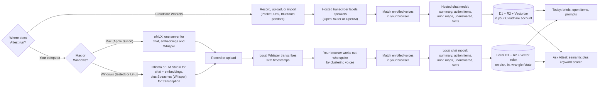

# Attest

**Record a conversation. Get back who said what, what was decided, what you owe people, and a memory of your work that gets smarter every week.**

Attest is a private, self-hosted voice notebook. Run it on **your own Mac** (with a local model server, nothing leaves the machine) or as a Worker in **your own Cloudflare account**. You record (or upload, or import from a Pocket device, an Omi account, or a Limitless pendant), and Attest gives you a speaker-labeled transcript, a summary, action items, mind maps, and a searchable memory of everything you have ever recorded. Then it uses that memory to run your day.


**Jump to:** [Why Attest](#why-attest) · [A day with Attest](#a-day-with-attest) · [Features](#features-at-a-glance) · [How it works](#how-it-works) · [Quick start](#quick-start) · [All the docs](#documentation)

---

## Why Attest

Most AI note-takers are a monthly subscription, keep your conversations on someone else's servers, and forget everything the moment the meeting ends. Attest is built the other way round.

- **Your conversations stay yours.** Run it on your own Mac, where nothing leaves the machine, or in your own Cloudflare account. There is no Attest company server, no sign-up, no plan and no usage limit. See [Privacy and security](docs/privacy.md#privacy-and-security).
- **It costs pennies, and you can see exactly what.** No subscription: you pay your AI provider directly, about **$0.10 for an hour of recording**, speakers included. Or pay nothing at all by [running it on your Mac](docs/run-locally.md#run-it-locally-on-a-mac-omlx). Every recording shows what it used. See the [cost comparison](docs/providers-and-costs.md#compare-routes).
- **It knows who said what, and never guesses.** Teach it a voice once and it recognises that person in later recordings. It only puts a name on someone when the transcript proves it, and a voice match stays a suggestion until you confirm it. Your audio is never sent anywhere to do this. See [Speakers and voices](docs/using-attest.md#speakers-and-voices).
- **It remembers, so you don't have to.** Every promise, decision and preference from every conversation is kept with the quote behind it. "What did Ben promise me?" gets an answer in seconds, with the source, instead of an hour of re-reading notes. See [Memory and semantic search](docs/using-attest.md#memory-and-semantic-search).
- **It plans your day.** Open Attest and Today shows what you owe people, what is waiting on you and what is overdue, with a daily brief and a weekly review that write themselves. Ten one-click prompts cover the rest: prep me for a person, what did I promise, coach me, and more. See [the Today screen](docs/using-attest.md#the-today-screen).
- **No lock-in.** Use OpenRouter or OpenAI, or a model on your own Mac, and switch whenever you like without redeploying anything. See [Providers and keys](docs/providers-and-costs.md#providers-and-keys).

> Attest is not a hosted service. You run it yourself, so no one else operates a server that holds your recordings. The only thing that ever leaves your setup is what you send to the AI provider you chose, and with a model on your Mac, not even that.


## A day with Attest

1. **Morning.** Open Attest. Today shows a brief of what you committed to, who is waiting on you, and what is unresolved. Three action items are flagged overdue.
2. **Meeting.** Hit Record (or drop in a file, or let your Pocket device sync). Attest transcribes it, labels the speakers, recognises two of them by voice, then summarizes with their names in it.
3. **Right after.** You confirm one suggested name with a click. You tick off an action item. Both are saved.
4. **Before a call.** Pick a person, click **Prep me for [person]**. You get the last few conversations in brief, open items in both directions, and what they care about, with quotes as evidence.
5. **Friday.** The weekly review has already written itself: themes, decisions, unresolved questions, one thing to focus on next week.
6. **Any time.** Ask Attest "who owes me a decision?" and it answers from the right passages across everything you have recorded, with citations.


## Features at a glance

| | What you get | Needs | Details |
|---|---|---|---|
| **Record, upload, import** | Browser recorder with live preview and crash recovery, file upload, Pocket import, Omi import | nothing extra (Pocket and Omi need a key) | [Recording](docs/using-attest.md#recording-uploading-importing) |
| **One recording, one conversation** | Dead air is trimmed, different conversations are split apart, and pieces of one call are joined back together. Originals are kept and every change can be undone | nothing | [Conversation shaping](docs/using-attest.md#conversation-shaping-one-recording-one-conversation) |
| **Areas** | Every recording is filed under Work, Personal, Health or Learning, picked for you and easy to change; one dropdown at the top shows only one area | nothing | [Areas](docs/using-attest.md#areas-work-personal-health-learning) |
| **Devices you choose** | Tick the ones you use (the app, Pocket, Omi, a Limitless pendant); the main screen, setup and background sync follow your choice | nothing | [Choosing your devices](docs/cloudflare-reference.md#choosing-your-devices) |
| **Phone and Mac app** | Attest in a native shell, a bottom tab bar on phones, an optional **Face ID lock**, and a **Bluetooth pendant sync** with background upload on iPhone | an Apple developer account to run it on your phone | [apple/README.md](apple/README.md) |
| **Speaker labels** | Who said what, from OpenAI's diarize model or OpenRouter models that label speakers | a labeling transcriber | [Speakers and voices](docs/using-attest.md#speakers-and-voices) |
| **Evidence-only names** | A name is kept only if a quote proves it; otherwise `Unknown 1..N` | nothing | [Speakers and voices](docs/using-attest.md#speakers-and-voices) |
| **Voice recognition** | Enrolled voices recognised on any provider, in your browser | a 49 MB model, downloaded once | [Speakers and voices](docs/using-attest.md#speakers-and-voices) |
| **88 summary presets** | Meeting, sales call, interview, lecture, medical visit, and 80 more, plus your own | nothing | [Summaries and mind maps](docs/using-attest.md#summaries-and-mind-maps) |
| **Three mind maps** | Topic, driver (decisions and actions), people | nothing | [Summaries and mind maps](docs/using-attest.md#summaries-and-mind-maps) |
| **Today screen** | A daily brief that leads the screen (do first, due and overdue, waiting on others, decisions, who to follow up with), a to-do list sorted by when it matters, a weekly review, 10 prefilled prompts | nothing | [The Today screen](docs/using-attest.md#the-today-screen) |
| **Memory** | Verified facts per recording, plus talk balance and unanswered questions | nothing | [Memory and semantic search](docs/using-attest.md#memory-and-semantic-search) |
| **Semantic search** | Ask by meaning across your whole history | Workers AI and Vectorize (free allowances, set up by deploy) | [Memory and semantic search](docs/using-attest.md#memory-and-semantic-search) |
| **Ask Attest** | Chat threads, plus a deeper 3-pass research mode | nothing | [Ask Attest](docs/using-attest.md#ask-attest) |
| **Export** | `.md`, `.docx`, a `.zip` of everything, print to PDF | nothing | [Export](docs/using-attest.md#export) |
| **Run it locally** | Everything on your Mac with [oMLX](https://github.com/jundot/omlx): $0 in API fees, nothing leaves the machine, with semantic search and speaker detection by voice | Apple Silicon Mac | [Run it locally](docs/run-locally.md#run-it-locally-on-a-mac-omlx) |
| **Lockdown by default** | Refuses every request until Cloudflare Access is in front of it | a Cloudflare account | [Privacy and security](docs/privacy.md#privacy-and-security) |


## How it works



**On Cloudflare**, everything is one Worker with owner-scoped rows. Your browser tab drives processing, and a free 15-minute cron picks up Pocket and Omi imports (the ones you ticked) and builds memory for older recordings. Start at [Route A](#route-a-cloudflare--openrouter).

**On your own computer** (a Mac, or a Windows PC; Linux should work but is untried), the same Worker runs in Cloudflare's local runtime (`npm run local`) and talks to model servers on your machine: oMLX on a Mac, or Ollama (or LM Studio) plus Speaches on Windows. The Windows path has been run end to end on Windows 11 with Ollama and Speaches; LM Studio, whisper.cpp, Linux and deploying to Cloudflare *from* Windows have not been tried yet. Nothing leaves your computer, speakers are detected in your browser rather than by the transcriber, and there is no background cron: use **Build memory from past recordings** and **Import from Pocket** instead. Start at [Route B](#route-b-this-mac-only), or [Windows or Linux](docs/run-locally.md#run-it-locally-on-windows-or-linux).

Details for both are in [For developers](docs/developing.md#for-developers).


## Quick start

> **New here? Follow the [step-by-step setup guide](docs/setup.md).** It is a complete, step-by-step guide for every route, written for someone who has never used a terminal, with a "you should see…" check after each step and a fix for each common problem.
>
> **The short version of our advice: use Route A (Cloudflare + OpenRouter) and accept every default.** It is the one that is simplest to keep working, works from your phone, and processes recordings while you sleep. Choose a local route only if keeping everything off the internet matters more than convenience.

**Pick one route.** Both give you the same app; they differ in where it runs and what it costs.

| | **A. Cloudflare + OpenRouter** | **B. This Mac only (oMLX)** |
|---|---|---|
| Open it from | any device, a phone included | the Mac it runs on |
| Costs | about $0.10 per recorded hour | $0 in API fees |
| Needs | a Cloudflare account **and a domain** on it, an [OpenRouter](https://openrouter.ai/) or [OpenAI](https://platform.openai.com/) key | an Apple Silicon Mac (macOS 15+) with [oMLX](https://github.com/jundot/omlx) |
| Setup time | about 20 minutes, mostly dashboard clicking | about 15 minutes, mostly waiting for model downloads |
| Background sync (Pocket, Omi) | yes | no |

**Both routes need** [Node.js](https://nodejs.org/) 22.12 or newer: the install, the local server and the Cloudflare deploy all run on it. Then get the code and install it. With [Git](https://git-scm.com/downloads):

```bash
git clone https://github.com/techjeffe/Attest.git
cd Attest
npm install
```

No Git? Use **Code, then Download ZIP** on the [repository page](https://github.com/techjeffe/Attest), unzip it, open a terminal in that folder, and run `npm install`.

### Route A: Cloudflare + OpenRouter

First [create a free Cloudflare account](https://dash.cloudflare.com/sign-up) with a domain on it, and an [OpenRouter key](https://openrouter.ai/keys). The one-time dashboard steps are in the [Full setup guide](docs/cloudflare-reference.md#full-setup-guide).

```bash
npx wrangler login   # opens your browser to sign in to Cloudflare
npm run deploy       # a wizard asks for your hostname, email and API key
```

When the wizard asks for a provider, press Enter (the default is `openrouter`) and accept the defaults (`openai/gpt-oss-20b` for chat, `microsoft/mai-transcribe-2` for transcription). That is [the recommended route](docs/providers-and-costs.md#the-recommended-route). Then open your hostname, sign in with the emailed code, and record something short.

### Route B: This Mac only

1. **Install oMLX** from its [official repository](https://github.com/jundot/omlx) ([site](https://omlx.ai)) and start its server. Set an API key in its settings; Attest will ask for it.
2. **Download three models inside oMLX** (its admin page, Models, search Hugging Face): one for chat, one for transcription, one for embeddings. [Which ones](docs/run-locally.md#models-to-download) and why.
3. Back in this folder:

```bash
npm run setup:local   # finds your oMLX, tests each model, writes .dev.vars
npm run local         # then open http://localhost:8787
```

If anything fails, `npm run local:check` says which model or step and how to fix it. Details: [Run it locally on a Mac](docs/run-locally.md#run-it-locally-on-a-mac-omlx).

**On Windows or Linux?** Same commands, with LM Studio or Ollama in place of oMLX and a separate Whisper server for transcription: see [Run it locally on Windows or Linux](docs/run-locally.md#run-it-locally-on-windows-or-linux).

Want to hack on the code instead? See [Local dev](docs/cloudflare-reference.md#local-dev).

---

## Documentation

| | |
|---|---|
| [Step-by-step setup](docs/setup.md) | A click-by-click walkthrough for all three ways to run Attest, written for non-programmers |
| [Cloudflare setup reference](docs/cloudflare-reference.md) | The technical details of a Cloudflare deploy: R2, Zero Trust, the API token, devices, background sync |
| [Run it locally](docs/run-locally.md) | A Mac with oMLX, or Windows and Linux, with nothing leaving the machine |
| [Using Attest](docs/using-attest.md) | Recording, speakers and voices, areas, the interface, Today, memory, Ask, export |
| [Providers, settings and cost](docs/providers-and-costs.md) | Choosing OpenAI, OpenRouter or a local model, and what each costs |
| [Phone and Mac app](apple/README.md) | The native app, the Bluetooth pendant sync, and running it on your iPhone |
| [Privacy and security](docs/privacy.md) | What stays where, and how Attest is locked down |
| [Troubleshooting and known limits](docs/troubleshooting.md) | Fixes, and what Attest does not do |
| [Developing](docs/developing.md) | Architecture, tests, contributing |

---

## License / no warranty

[MIT](LICENSE). Use it, fork it, deploy it; keep the copyright notice and license text in copies and forks, and a link back is appreciated. There is no warranty of any kind, and you are responsible for your own Cloudflare bill, AI provider bill, and any data you put through it.
